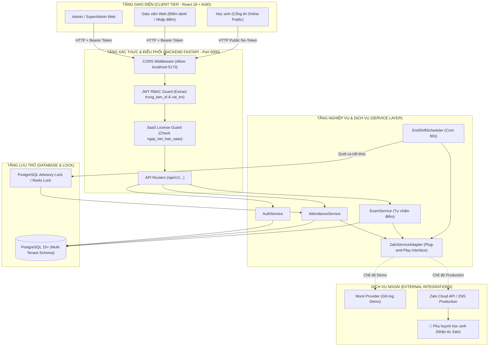
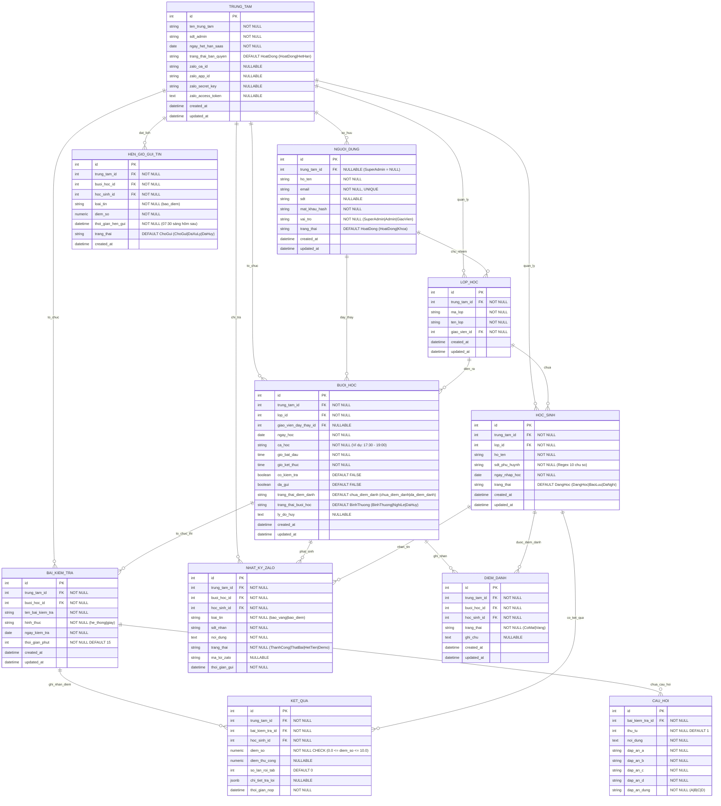
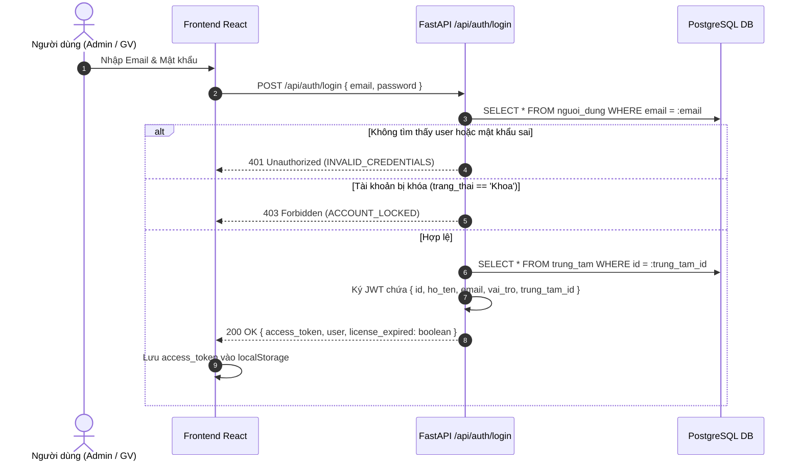
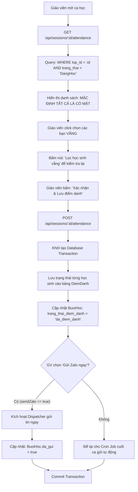
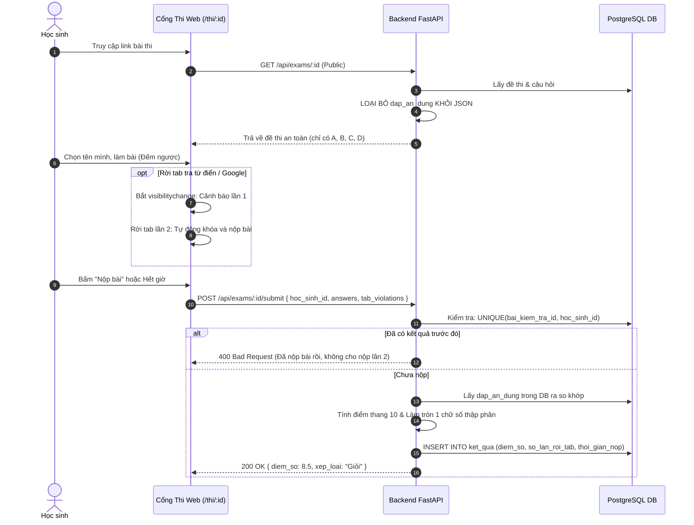
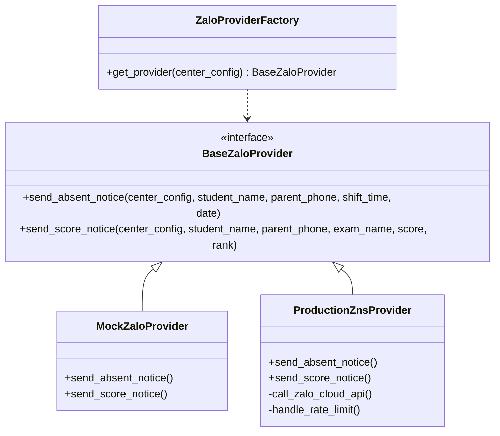
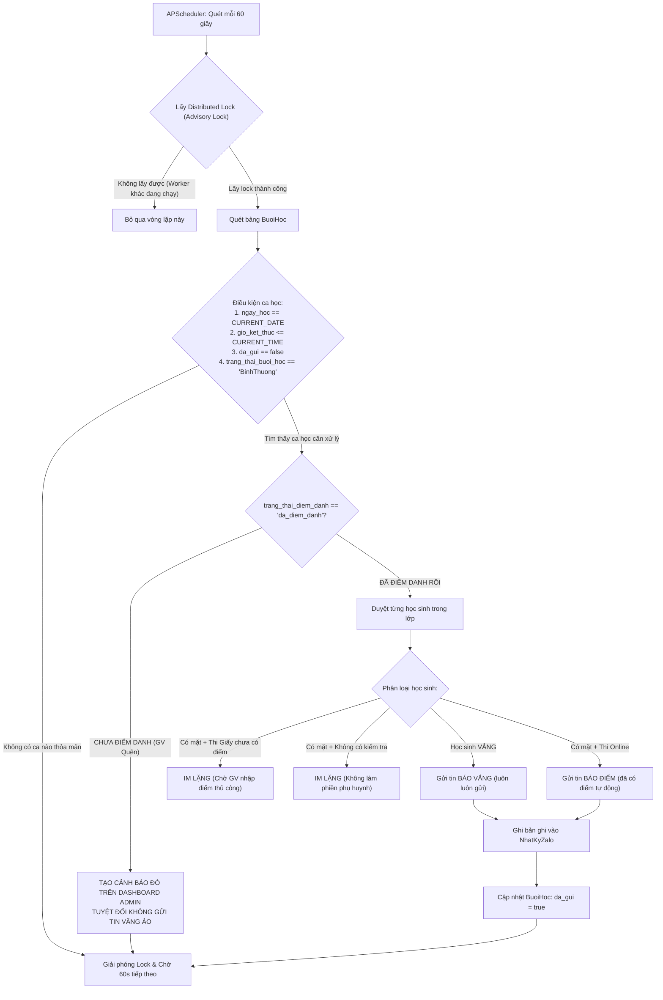

# 🏗️ KẾ HOẠCH THIẾT KẾ & TRIỂN KHAI BACKEND PYTHON (BACKEND ARCHITECT PLAN)
## DỰ ÁN: TOOL QUẢN LÝ TRUNG TÂM TIẾNG ANH – B2B SAAS

> **Vai trò:** Senior Python Backend Architect & Technical Lead  
> **Tài liệu căn cứ:** `LO_TRINH_DU_AN.md`, `SO_DO_HE_THONG.md`, `TONG_KET_FRONTEND.md`  
> **Frontend Stack:** React 18 + Vite + Ant Design 5.x + Axios Client + Recharts  
> **Trạng thái tài liệu:** Bản kế hoạch thiết kế kiến trúc hoàn chỉnh (Ready for Implementation)  
> **Nguyên tắc:** Kế hoạch độc lập, không chỉnh sửa/ghi đè bất kỳ file mã nguồn hoặc tài liệu có sẵn nào trong repository.

---

## MỤC LỤC TỔNG QUAN

1. [PHẦN 1: TỔNG QUAN KIẾN TRÚC BACKEND & SO SÁNH TECH STACK](#phần-1-tổng-quan-kiến-trúc-backend--so-sánh-tech-stack)
2. [PHẦN 2: CẤU TRÚC THƯ MỤC PYTHON CHUẨN ENTERPRISE](#phần-2-cấu-trúc-thư-mục-python-chuẩn-enterprise)
3. [PHẦN 3: THIẾT KẾ CƠ SỞ DỮ LIỆU (DATABASE ERD & CONSTRAINTS)](#phần-3-thiết-kế-cơ-sở-dữ-liệu-database-erd--constraints)
4. [PHẦN 4: THIẾT KẾ API TƯƠNG THÍCH 100% FRONTEND (API CONTRACT)](#phần-4-thiết-kế-api-tương-thích-100-frontend-api-contract)
5. [PHẦN 5: PHÂN TÍCH & GIẢI THUẬT 13 LUỒNG NGHIỆP VỤ BẮT BUỘC](#phần-5-phân-tích--giải-thuật-13-luồng-nghiệp-vụ-bắt-buộc)
6. [PHẦN 6: KẾ HOẠCH TRIỂN KHAI CHI TIẾT THEO 12 GIAI ĐOẠN](#phần-6-kế-hoạch-triển-khai-chi-tiết-theo-12-giai-đoạn)
7. [PHẦN 7: CHIẾN LƯỢC KIỂM THỬ (TEST PLAN) & MA TRẬN EDGE CASES](#phần-7-chiến-lược-kiểm-thử-test-plan--ma-trận-edge-cases)
8. [PHẦN 8: BẢNG RỦI RO & CÁC VẤN ĐỀ CẦN XÁC NHẬN VỚI NHÓM](#phần-8-bảng-rủi-ro--các-vấn-đề-cần-xác-nhận-với-nhóm)

---

# PHẦN 1: TỔNG QUAN KIẾN TRÚC BACKEND & SO SÁNH TECH STACK

### 1.1. Bảng So Sánh & Lựa Chọn Python Web Framework

| Tiêu chí so sánh | **FastAPI (Đề xuất chính thức)** | **Django REST Framework (DRF)** | **Flask** |
| :--- | :--- | :--- | :--- |
| **Kiến trúc I/O & Hiệu năng** | ⚡ **Async Native (ASGI - Starlette/Uvicorn)**. Xử lý đồng thời hàng nghìn request, hỗ trợ gọi không nghẽn (non-blocking) sang Zalo Cloud API. | **WSGI đồng bộ truyền thống**. Hỗ trợ Async ở các phiên bản gần đây nhưng ORM và hệ sinh thái middleware vẫn mang nặng tính đồng bộ. | Khá nhanh nhưng WSGI đồng bộ; cấu hình async rời rạc, không tối ưu cho high concurrency. |
| **Data Validation & Typing** | **Tích hợp sâu Pydantic v2 (Rust-based core)**. Tốc độ kiểm tra kiểu dữ liệu nhanh gấp 5-10 lần, tự động parse số điện thoại, điểm số, format chuỗi. | Dựa vào `serializers.Serializer` của DRF. Cú pháp dài dòng, validation chậm hơn Pydantic. | Phải tích hợp thêm thư viện bên ngoài như Marshmallow hoặc Pydantic thủ công. |
| **OpenAPI / Swagger Docs** | **Tự động sinh tài liệu chuẩn xác 100%** tại `/docs` (Swagger UI) và `/redoc` từ Type Hints và Pydantic Schemas. | Cần cài thêm thư viện ngoài (`drf-spectacular` hoặc `drf-yasg`), cấu hình phức tạp. | Phải dùng thư viện ngoài (`flasgger`), bảo trì khó khăn. |
| **Kiến trúc Multi-tenant SaaS** | **Cực kỳ linh hoạt với Dependency Injection (`Depends`)**. Dễ dàng bóc tách `trung_tam_id` từ JWT và ép bộ lọc vào mọi Service/Repository. | Buộc phải can thiệp sâu vào `QuerySet` hoặc cài đặt package nặng như `django-tenants`. | Linh hoạt nhưng thiếu hệ thống Dependency Injection chuẩn hóa. |
| **Độ phức tạp & Kích thước** | Nhẹ, phân tách tầng rõ ràng (Clean/Modular Architecture), không có code thừa. | Nặng (Monolithic), đi kèm Django Admin, Session Auth, Template Engine không cần thiết cho REST API. | Quá tối giản, lập trình viên phải tự viết lại toàn bộ khung cấu trúc dự án doanh nghiệp. |

> **Khẳng định lựa chọn:** **FastAPI** là công nghệ tối ưu hàng đầu cho dự án này. FastAPI đáp ứng hoàn hảo yêu cầu Non-blocking Async I/O cho bộ điều phối gửi tin Zalo, kiểm tra dữ liệu chặt chẽ bằng Pydantic v2, và tương thích tự nhiên với cấu trúc Axios Client hiện có của Frontend.

---

### 1.2. Đánh Giá & Lựa Chọn Các Thành Phần Kỹ Thuật Khác

#### A. Database & ORM
- **Database:** **PostgreSQL 15+**
  - *Lý do:* Đảm bảo chuẩn toàn vẹn ACID cao cấp, hỗ trợ kiểu dữ liệu `NUMERIC(3, 1)` cho điểm số, native `JSONB` cho chi tiết bài thi trắc nghiệm, và hỗ trợ `Advisory Locks` (khóa cấp cơ sở dữ liệu) để chống chạy trùng Cron Job mà không bắt buộc phải phụ thuộc ngay vào hạ tầng Redis phức tạp ở giai đoạn MVP.
- **ORM:** **SQLAlchemy 2.0 (Async Engine)** kết hợp driver **asyncpg**.
  - *Lý do:* SQLAlchemy 2.0 mang lại Typed-Safe Query chuẩn mực, tách biệt rõ ràng giữa Data Model và Service Layer, hiệu năng cao nhất trong các thư viện ORM Python.
- **Database Migration:** **Alembic**
  - *Lý do:* Công cụ theo dõi schema chính thức của SQLAlchemy, tạo file migration tự động (`autogenerate`), kiểm soát lịch sử nâng cấp/hạ cấp CSDL an toàn.

#### B. Authentication & Authorization (RBAC)
- **Chuẩn mã hóa mật khẩu:** `passlib[bcrypt]` với salt an toàn (chống Rainbow Table, Brute-force).
- **Cơ chế Token:** `PyJWT` thuật toán ký `HS256`, thời hạn sống của Access Token: 24 giờ.
- **Payload JWT:** Chuẩn hóa đúng yêu cầu Frontend:
  ```json
  {
    "id": 1,
    "ho_ten": "Nguyễn Văn A",
    "email": "teacher.a@english.edu.vn",
    "vai_tro": "GiaoVien",
    "trung_tam_id": 1,
    "exp": 1799999999
  }
  ```
- **RBAC Enforcement:** Sử dụng cơ chế Dependency Injection của FastAPI (`Depends(require_role([...]))`) kết hợp middleware kiểm tra quyền sở hữu bản ghi (IDOR Prevention).

#### C. Scheduler & Task Runner
- **APScheduler 3.x (`AsyncIOScheduler`):**
  - *Lý do:* Chạy trực tiếp trong cùng Async Event Loop của tiến trình FastAPI, không cần cài đặt thêm Broker bên ngoài như RabbitMQ hay Celery Worker cồng kềnh cho giai đoạn MVP, hoàn toàn đáp ứng được Cron Job quét định kỳ mỗi 60 giây và lịch hẹn giờ 07:30 sáng.
- **Redis (Khuyến nghị cho Production):**
  - Trong giai đoạn MVP: Sử dụng `PostgreSQL Advisory Lock` để kiểm soát concurrency. Khi hệ thống mở rộng lên nhiều container backend (horizontal scaling), Redis 7 sẽ đóng vai trò Distributed Lock (`redis-py`) và hàng đợi tin nhắn.

#### D. Kiểm Thử (Testing)
- **Pytest** + **pytest-asyncio** + **pytest-mock** + **httpx (`AsyncClient`)**: Cho phép kiểm thử End-to-End toàn bộ API Endpoint bất đồng bộ với tốc độ thực thi chỉ trong vài giây.

---

### 1.3. Sơ Đồ Kiến Trúc & Luồng Dữ Liệu Toàn Hệ Thống



---

# PHẦN 2: CẤU TRÚC THƯ MỤC PYTHON CHUẨN ENTERPRISE

Cấu trúc dự án `backend/` được thiết kế theo mô hình **Clean Modular Architecture** (Phân tách rõ ràng giữa Router, Schema, Service, Model và Task):

```
backend/
├── app/
│   ├── __init__.py
│   ├── main.py                     # Entry point khởi tạo FastAPI, gắn CORS, Router, Lifespan Scheduler
│   │
│   ├── api/                        # Tầng Giao tiếp HTTP (API Routers)
│   │   ├── __init__.py
│   │   ├── deps.py                 # Dependency Injection: db_session, current_user, current_tenant, role_checker
│   │   └── v1/
│   │       ├── __init__.py
│   │       ├── api.py              # Gom toàn bộ sub-routers với prefix /api
│   │       └── endpoints/
│   │           ├── auth.py         # /api/auth/login, /api/auth/logout, /api/auth/me
│   │           ├── centers.py      # /api/centers (CRUD, gia hạn bản quyền, cấu hình Zalo ZNS)
│   │           ├── teachers.py     # /api/teachers (CRUD tài khoản giáo viên, khóa/mở)
│   │           ├── classes.py      # /api/classes (CRUD lớp học, sĩ số, phân công giáo viên)
│   │           ├── students.py     # /api/students (CRUD học sinh, validate SĐT VN, chuyển trạng thái)
│   │           ├── sessions.py     # /api/sessions (Lịch dạy, hủy buổi, nghỉ lễ, chỉ định dạy thay)
│   │           ├── attendance.py   # /api/sessions/:id/attendance (Điểm danh, lọc học sinh vắng)
│   │           ├── exams.py        # /api/exams (Tạo đề, nộp bài trắc nghiệm, nhập điểm thi giấy)
│   │           ├── results.py      # /api/exams/:id/results, /api/students/:id/results
│   │           ├── zalo_logs.py    # /api/zalo-logs (Tra cứu lịch sử tin, thống kê chi phí Recharts)
│   │           └── dashboard.py    # /api/dashboard/stats, /api/dashboard/alerts (Cảnh báo ca chưa điểm danh)
│   │
│   ├── core/                       # Cấu hình lõi & Hạ tầng dùng chung
│   │   ├── __init__.py
│   │   ├── config.py               # Đọc biến môi trường Pydantic Settings (.env, Database URL, JWT Secret)
│   │   ├── database.py             # Cấu hình AsyncEngine, async_sessionmaker (SQLAlchemy 2.0)
│   │   ├── security.py             # Bcrypt hashing, sinh/giải mã JWT Token
│   │   ├── exceptions.py           # Custom Domain Exceptions (LicenseExpired, ResourceNotFound, IDORViolation)
│   │   └── constants.py            # Enums vai trò, trạng thái điểm danh, trạng thái Zalo, regex SĐT
│   │
│   ├── models/                     # Tầng Cơ sở dữ liệu (SQLAlchemy ORM Entities)
│   │   ├── __init__.py             # Export toàn bộ models để Alembic autogenerate
│   │   ├── base.py                 # Base ORM model, timestamp mixin (created_at, updated_at)
│   │   ├── center.py               # Entity TrungTam (Bản quyền SaaS, Zalo OA config)
│   │   ├── user.py                 # Entity NguoiDung (SuperAdmin, Admin, GiaoVien)
│   │   ├── class_room.py           # Entity LopHoc
│   │   ├── student.py              # Entity HocSinh
│   │   ├── session.py              # Entity BuoiHoc (Giờ bắt đầu/kết thúc, cờ điểm danh, trạng thái)
│   │   ├── attendance.py           # Entity DiemDanh (CoMat, Vang, ghi chú)
│   │   ├── exam.py                 # Entity BaiKiemTra, CauHoi (Đề thi online & giấy)
│   │   ├── result.py               # Entity KetQua (Điểm số 0.0 - 10.0, chống nộp trùng)
│   │   ├── zalo_log.py             # Entity NhatKyZalo (Lịch sử gửi tin, chống gửi trùng)
│   │   └── schedule_task.py        # Entity HenGioGuiTin (Hàng đợi gửi tin an toàn 07:30 sáng)
│   │
│   ├── schemas/                    # Tầng Data Transfer Objects (Pydantic v2 Schemas)
│   │   ├── __init__.py
│   │   ├── common.py               # GenericResponse[T], ErrorResponse, PaginationParams
│   │   ├── auth.py                 # LoginIn, TokenOut, UserOut
│   │   ├── center.py               # CenterCreate, CenterUpdate, LicenseUpdateIn, ZaloConfigIn
│   │   ├── teacher.py              # TeacherCreate, TeacherUpdate, TeacherOut
│   │   ├── class_room.py           # ClassCreate, ClassUpdate, ClassOut
│   │   ├── student.py              # StudentCreate, StudentUpdate, StudentStatusUpdateIn, StudentOut
│   │   ├── session.py              # SessionCreate, SessionCancelIn, SessionSubstituteIn, SessionOut
│   │   ├── attendance.py           # AttendanceItem, AttendanceSaveIn, AttendanceListOut
│   │   ├── exam.py                 # ExamCreate, QuestionIn, ExamPublicOut, ExamSubmitIn, ManualScoreIn
│   │   ├── result.py               # ResultOut, StudentResultSummaryOut
│   │   ├── zalo_log.py             # ZaloLogOut, ZaloStatsOut
│   │   └── dashboard.py            # DashboardStatsOut, AttendanceAlertOut
│   │
│   ├── services/                   # Tầng Xử lý Nghiệp vụ Logic (Business Layer)
│   │   ├── __init__.py
│   │   ├── auth_service.py         # Kiểm tra đăng nhập, cấp token, validate license
│   │   ├── center_service.py       # Nghiệp vụ quản lý trung tâm & cấp phép SaaS
│   │   ├── teacher_service.py      # Nghiệp vụ giáo viên & tài khoản
│   │   ├── class_service.py        # Nghiệp vụ lớp & sĩ số
│   │   ├── student_service.py      # Nghiệp vụ học sinh (Lọc DangHoc, kiểm tra SĐT VN)
│   │   ├── session_service.py      # Nghiệp vụ ca học, đổi lịch, điểm danh hộ
│   │   ├── attendance_service.py   # Nghiệp vụ điểm danh (Mặc định Có mặt, lưu trạng thái Vắng)
│   │   ├── exam_service.py         # Nghiệp vụ thi trắc nghiệm (Chấm tự động, làm tròn 1 chữ số, anti-cheat)
│   │   ├── result_service.py       # Quản lý kết quả thi, nhập điểm thi giấy từng phần
│   │   ├── dispatcher_service.py   # Bộ điều phối quyết định gửi tin theo cây logic nghiệp vụ
│   │   └── zalo/                   # Adapter Giao tiếp Zalo Service (Plug-and-Play)
│   │       ├── __init__.py
│   │       ├── base.py             # Interface BaseZaloProvider (send_absent_notice, send_score_notice)
│   │       ├── mock_provider.py    # Chế độ Demo: Mô phỏng gửi tin, ghi log DB
│   │       ├── zns_provider.py     # Chế độ Production: Gọi Zalo Cloud API thật
│   │       └── factory.py          # Factory cấp Provider tương ứng dựa trên cấu hình trung tâm
│   │
│   ├── tasks/                      # Tầng Tự động hóa & Scheduler (APScheduler)
│   │   ├── __init__.py
│   │   ├── scheduler.py            # Cấu hình AsyncIOScheduler gắn vào FastAPI lifespan
│   │   ├── locks.py                # Postgres Advisory Lock / Redis Lock chống chạy trùng
│   │   ├── end_shift_cron.py       # Trigger 1: Quét ca học kết thúc định kỳ mỗi 60 giây
│   │   └── morning_queue_cron.py   # Quét hàng đợi ban đêm gửi lúc 07:30 sáng hôm sau
│   │
│   └── middleware/                 # Middleware kiểm soát toàn cục
│       ├── __init__.py
│       ├── tenant_guard.py         # Middleware xác thực tenant context từ JWT
│       └── license_guard.py        # Chặn ghi (POST/PUT/DELETE) nếu trung tâm hết hạn bản quyền SaaS
│
├── alembic/                        # Cấu hình & Lịch sử Database Migrations
│   ├── env.py                      # Tích hợp SQLAlchemy AsyncEngine cho Alembic
│   ├── script.py.mako
│   └── versions/                   # Chứa các file migration .py
│
├── tests/                          # Tầng Kiểm thử tự động (Pytest)
│   ├── conftest.py                 # Fixtures: async_client, db_session, mock_tokens, sample_data
│   ├── test_auth.py                # Kiểm thử Đăng nhập, JWT, mã hóa mật khẩu
│   ├── test_tenant_isolation.py    # Kiểm thử cách ly dữ liệu đa trung tâm & IDOR
│   ├── test_students.py            # Kiểm thử CRUD học sinh, validate Regex SĐT VN
│   ├── test_attendance.py          # Kiểm thử điểm danh, loại học sinh bảo lưu
│   ├── test_online_exam.py         # Kiểm thử thi online: Tự chấm điểm, chống nộp lần 2, giấu đáp án
│   ├── test_manual_scores.py       # Kiểm thử thi giấy: Chặn điểm học sinh vắng, làm tròn số
│   ├── test_cron_end_shift.py      # Kiểm thử an toàn lưới: GV quên điểm danh không gửi tin vắng
│   └── test_zalo_adapter.py        # Kiểm thử rate limiter, bọc lỗi độc lập từng học sinh
│
├── alembic.ini                     # Cấu hình kết nối Alembic
├── requirements.txt                # Danh sách thư viện Python
├── .env.example                    # File mẫu biến môi trường
└── README.md                       # Hướng dẫn chạy backend và kiểm thử
```

---

# PHẦN 3: THIẾT KẾ CƠ SỞ DỮ LIỆU (DATABASE ERD & CONSTRAINTS)

### 3.1. Phân Tích & Đối Chiếu Bổ Sung So Với ERD Ban Đầu

Sau khi đối soát giữa ERD ban đầu trong `SO_DO_HE_THONG.md` và các quy tắc nghiệp vụ trong `LO_TRINH_DU_AN.md`, `TONG_KET_FRONTEND.md`, kiến trúc Backend bổ sung 4 điểm cải tiến bắt buộc:
1. **Bổ sung bảng `hen_gio_gui_tin` (Scheduled Tasks):** Hỗ trợ lưu trữ hàng đợi các tin thông báo điểm thi giấy phát sinh sau 21:30 đêm để gửi tự động lúc 07:30 sáng hôm sau. Việc lưu vào database đảm bảo hàng đợi không bị mất ngay cả khi server tắt/khởi động lại.
2. **Bổ sung cột `so_lan_roi_tab` và `chi_tiet_tra_loi` (JSONB) vào bảng `ket_qua`:** Phục vụ cơ chế chống gian lận khi thi trắc nghiệm online (Frontend phát hiện rời tab 2 lần tự nộp bài).
3. **Ràng buộc kiểu dữ liệu điểm số:** Kiểu `NUMERIC(3, 1)` kèm `CHECK (diem_so >= 0.0 AND diem_so <= 10.0)` để đảm bảo điểm luôn có tối đa 1 chữ số thập phân (ví dụ `7.3`, không bao giờ là `7.3333333333`).
4. **Cột định danh Tenant:** Tất cả các bảng dữ liệu nghiệp vụ đều sở hữu trường `trung_tam_id` để phân tách dữ liệu tuyệt đối giữa các trung tâm đối tác SaaS.

---

### 3.2. Sơ Đồ Thực Thể Quan Hệ Hoàn Chỉnh (Entity-Relationship Diagram)



---

### 3.3. Danh Sách Ràng Buộc Kỹ Thuật (Constraints & Indexes)

1. **Chống Nộp Trùng Bài Thi:**
   - Bảng `ket_qua`: `UNIQUE (bai_kiem_tra_id, hoc_sinh_id)`
   - *Ý nghĩa:* Ngăn chặn triệt để học sinh F5 hoặc gửi request nộp bài nhiều lần.
2. **Chống Trùng Mã Lớp Trong Cùng Trung Tâm:**
   - Bảng `lop_hoc`: `UNIQUE (trung_tam_id, ma_lop)`
   - *Ý nghĩa:* Cho phép các trung tâm khác nhau có cùng mã lớp `A1-2026`, nhưng trong cùng 1 trung tâm mã lớp là duy nhất.
3. **Chống Trùng Bản Ghi Điểm Danh:**
   - Bảng `diem_danh`: `UNIQUE (buoi_hoc_id, hoc_sinh_id)`
   - *Ý nghĩa:* Trong 1 ca học, mỗi học sinh chỉ có duy nhất 1 trạng thái điểm danh.
4. **Idempotency Chống Gửi Trùng Thông Báo Zalo:**
   - Bảng `nhat_ky_zalo`: `UNIQUE (buoi_hoc_id, hoc_sinh_id, loai_tin)`
   - *Ý nghĩa:* Đảm bảo 1 học sinh trong 1 buổi học chỉ nhận tối đa 1 tin `bao_vang` HOẶC 1 tin `bao_diem`.
5. **Kiểm Soát Tính Đúng Đắn Của Số Điện Thoại Phụ Huynh:**
   - Cột `sdt_phu_huynh` trong bảng `hoc_sinh` **không được đặt UNIQUE** (vì 1 phụ huynh có thể có 2-3 con cùng theo học tại trung tâm).
6. **Chỉ Mục Hiệu Năng (Composite Indexes):**
   - `CREATE INDEX idx_hocsinh_tenant_lop_status ON hoc_sinh(trung_tam_id, lop_id, trang_thai);`
   - `CREATE INDEX idx_buoihoc_cron ON buoi_hoc(ngay_hoc, gio_ket_thuc, da_gui, trang_thai_diem_danh, trang_thai_buoi_hoc);`
   - `CREATE INDEX idx_zalo_tenant_thang ON nhat_ky_zalo(trung_tam_id, thoi_gian_gui);`
   - `CREATE INDEX idx_hengui_cron ON hen_gio_gui_tin(trang_thai, thoi_gian_hen_gui);`

---

# PHẦN 4: THIẾT KẾ API TƯƠNG THÍCH 100% FRONTEND (API CONTRACT)

### Quy Chuẩn Định Dạng Dữ Liệu:
- **Base URL:** `http://localhost:5000/api`
- **Authentication Header:** `Authorization: Bearer <JWT_TOKEN>`
- **Chuẩn cấu trúc Success Response:**
  ```json
  {
    "success": true,
    "data": {},
    "message": "Thông báo thành công"
  }
  ```
- **Chuẩn cấu trúc Error Response:**
  ```json
  {
    "success": false,
    "error_code": "RESOURCE_NOT_FOUND",
    "message": "Chi tiết lỗi xảy ra",
    "details": null
  }
  ```

---

### 4.1. Bảng Đối Chiếu Toàn Bộ API Endpoints

| Method | Endpoint | Request Payload / Params | Response Data | Quyền truy cập (RBAC) | Trạng thái |
| :---: | :--- | :--- | :--- | :---: | :---: |
| `POST` | `/api/auth/login` | `{ email, password }` | `{ access_token, token_type, user }` | Public | Cần dựng |
| `POST` | `/api/auth/logout` | Không | `{}` | Đã đăng nhập | Cần dựng |
| `GET` | `/api/auth/me` | Không | `{ id, ho_ten, email, vai_tro, trung_tam_id, ten_trung_tam }` | Đã đăng nhập | Cần dựng |
| `GET` | `/api/students` | Query: `classId`, `status`, `search` | `Array<StudentOut>` | SuperAdmin, Admin, GiaoVien | Cần dựng |
| `POST` | `/api/students` | `{ ho_ten, sdt_phu_huynh, lop_id, ngay_nhap_hoc }` | `StudentOut` | Admin | Cần dựng |
| `GET` | `/api/students/:id` | Path: `id` | `StudentOut` | Admin, GiaoVien | Cần dựng |
| `PUT` | `/api/students/:id` | `{ ho_ten, sdt_phu_huynh, lop_id, ngay_nhap_hoc }` | `StudentOut` | Admin | Cần dựng |
| `PATCH` | `/api/students/:id/status` | `{ trang_thai: "DangHoc" \| "BaoLuu" \| "DaNghi" }` | `StudentOut` | Admin | Cần dựng |
| `DELETE` | `/api/students/:id` | Path: `id` | `{ message }` | Admin | Cần dựng |
| `GET` | `/api/classes` | Query: `teacherId`, `search` | `Array<ClassOut>` kèm sĩ số, tên GV | SuperAdmin, Admin, GiaoVien | Cần dựng |
| `POST` | `/api/classes` | `{ ma_lop, ten_lop, giao_vien_id }` | `ClassOut` | Admin | Cần dựng |
| `GET` | `/api/classes/:id` | Path: `id` | `ClassOut` kèm danh sách học sinh | Admin, GiaoVien | Cần dựng |
| `PUT` | `/api/classes/:id` | `{ ma_lop, ten_lop, giao_vien_id }` | `ClassOut` | Admin | Cần dựng |
| `DELETE` | `/api/classes/:id` | Path: `id` | `{ message }` | Admin | Cần dựng |
| `GET` | `/api/teachers` | Query: `search`, `status` | `Array<TeacherOut>` kèm danh sách lớp | SuperAdmin, Admin | Cần dựng |
| `POST` | `/api/teachers` | `{ ho_ten, email, sdt, mat_khau }` | `TeacherOut` | Admin | Cần dựng |
| `GET` | `/api/teachers/:id` | Path: `id` | `TeacherOut` | SuperAdmin, Admin | Cần dựng |
| `PUT` | `/api/teachers/:id` | `{ ho_ten, sdt, ... }` | `TeacherOut` | Admin | Cần dựng |
| `PATCH` | `/api/teachers/:id/status` | `{ trang_thai: "HoatDong" \| "Khoa" }` | `TeacherOut` | Admin | Cần dựng |
| `GET` | `/api/sessions` | Query: `date`, `classId` | `Array<SessionOut>` | Admin, GiaoVien | Cần dựng |
| `POST` | `/api/sessions` | `{ lop_id, ngay_hoc, ca_hoc, gio_bat_dau, gio_ket_thuc, co_kiem_tra }` | `SessionOut` | Admin | Cần dựng |
| `GET` | `/api/sessions/:id` | Path: `id` | `SessionOut` chi tiết | Admin, GiaoVien | Cần dựng |
| `PATCH` | `/api/sessions/:id/cancel` | `{ reason: "..." }` | `SessionOut` (`trang_thai_buoi_hoc = 'DaHuy'`) | Admin | Cần dựng |
| `PATCH` | `/api/sessions/:id/substitute` | `{ giao_vien_id: 3 }` | `SessionOut` (Gán GV dạy thay) | Admin | Cần dựng |
| `PATCH` | `/api/sessions/:id/confirm-attendance` | Path: `id` | `SessionOut` (`trang_thai_diem_danh = 'da_diem_danh'`) | Admin, GiaoVien | Cần dựng |
| `GET` | `/api/sessions/:id/attendance` | Path: `sessionId` | `{ buoi_hoc, students: [...] }` (Chỉ lọc `DangHoc`) | Admin, GiaoVien | Cần dựng |
| `POST` | `/api/sessions/:id/attendance` | `{ attendance: { "1": "CoMat", "2": "Vang" }, sendZalo: true, scores: { ... } }` | `{ success: true, count_absent, count_score }` | Admin, GiaoVien | Cần dựng |
| `POST` | `/api/exams` | `{ ten_bai_kiem_tra, hinh_thuc, thoi_gian_phut, questions: [...] }` | `ExamOut` | Admin, GiaoVien | Cần dựng |
| `GET` | `/api/exams` | Query: `buoi_hoc_id` | `Array<ExamOut>` | Admin, GiaoVien | Cần dựng |
| `GET` | `/api/exams/:id` | Path: `id` | `ExamPublicOut` (ĐÃ LỌC BỎ `dap_an_dung`) | Public (Học sinh) | Cần dựng |
| `POST` | `/api/exams/:id/questions` | `{ questions: [...] }` | `ExamOut` | Admin, GiaoVien | Cần dựng |
| `POST` | `/api/exams/:id/submit` | `{ hoc_sinh_id, answers, tab_violations, is_auto_submit }` | `{ diem_so, so_cau_dung, tong_cau, xep_loai }` | Public (Học sinh) | Cần dựng |
| `POST` | `/api/exams/:id/manual-scores` | `{ scores: { "1": 8.5, "2": 7.0 }, scheduleForMorning: false }` | `{ updated_count, queued_count, sent_count }` | Admin, GiaoVien | Cần dựng |
| `GET` | `/api/exams/:id/results` | Path: `examId` | `Array<ResultOut>` | Admin, GiaoVien | Cần dựng |
| `GET` | `/api/students/:id/results` | Path: `studentId` | `Array<StudentResultOut>` | Admin, GiaoVien | Cần dựng |
| `GET` | `/api/zalo-logs` | Query: `date`, `loai_tin`, `trang_thai`, `search`, `page`, `limit` | `{ items: [...], total, page, limit }` | SuperAdmin, Admin | Cần dựng |
| `GET` | `/api/zalo-logs/stats` | Query: `months=6` | `Array<{ thang, thanh_cong, that_bai, het_tien }>` | SuperAdmin, Admin | Cần dựng |
| `GET` | `/api/dashboard/stats` | Không | `{ totalStudents, totalClasses, totalTeachers, totalMessagesSent }` | SuperAdmin, Admin | Cần dựng |
| `GET` | `/api/dashboard/alerts` | Không | `Array<{ id, lop, giao_vien, ca, ngay_hoc, trang_thai }>` | Admin | Cần dựng |
| `GET` | `/api/centers` | Không | `Array<CenterOut>` | SuperAdmin | Cần dựng |
| `POST` | `/api/centers` | `{ ten_trung_tam, sdt_admin, email_admin, mat_khau_admin, so_nam: 1 }` | `CenterOut` | SuperAdmin | Cần dựng |
| `GET` | `/api/centers/:id` | Path: `id` | `CenterOut` chi tiết | SuperAdmin, Admin | Cần dựng |
| `PATCH` | `/api/centers/:id/license` | `{ ngay_het_han_saas, so_nam_gia_han }` | `CenterOut` | SuperAdmin | Cần dựng |
| `PATCH` | `/api/centers/:id/zalo-config` | `{ zalo_oa_id, zalo_app_id, zalo_secret_key, zalo_access_token }` | `CenterOut` (Không trả về secret_key) | SuperAdmin | Cần dựng |

---

### 4.2. Chi Tiết Một Số Endpoint Trọng Yếu & Xử Lý Lỗi

#### 1. Đăng nhập: `POST /api/auth/login`
- **Validation:** `email` đúng định dạng, `password` tối thiểu 6 ký tự.
- **Xử lý nghiệp vụ:**
  - Kiểm tra tồn tại user qua email.
  - Kiểm tra `trang_thai == 'HoatDong'`. Nếu bị khóa, trả về lỗi `403 Forbidden` (`USER_ACCOUNT_LOCKED`).
  - So khớp mật khẩu với hash bcrypt. Nếu sai, trả về `401 Unauthorized` (`INVALID_CREDENTIALS`).
  - Nếu user thuộc trung tâm: Đọc `TrungTam`. Nếu trung tâm hết hạn bản quyền, vẫn cho phép đăng nhập nhưng đính kèm cảnh báo `license_status = 'HetHan'` để Frontend chuyển sang chế độ chỉ xem.

#### 2. Lấy dữ liệu điểm danh: `GET /api/sessions/:id/attendance`
- **Bảo mật & Nghiệp vụ cốt lõi:**
  - Lọc học sinh: `WHERE lop_id = session.lop_id AND trang_thai = 'DangHoc'`.
  - **Tuyệt đối loại bỏ** học sinh `BaoLuu` và `DaNghi`.
  - Nếu buổi học chưa có bản ghi điểm danh trong DB: Trả về danh sách học sinh với mặc định `trang_thai: "CoMat"` cho toàn bộ học sinh để giáo viên chỉ cần tick bạn Vắng.

#### 3. Cổng thi trắc nghiệm học sinh: `GET /api/exams/:id`
- **Bảo mật Anti-Cheat:**
  - Endpoint là **Public** để học sinh mở link làm bài ngay trên điện thoại/máy tính mà không cần đăng nhập.
  - **Lọc bỏ hoàn toàn trường `dap_an_dung`** khỏi câu trả lời của API. Học sinh mở F12 DevTools hoặc inspect Network response cũng không thể lấy được đáp án đúng.

#### 4. Nộp bài thi trắc nghiệm: `POST /api/exams/:id/submit`
- **Bảo mật & Tính điểm:**
  - Backend kiểm tra `UNIQUE(bai_kiem_tra_id, hoc_sinh_id)`. Nếu học sinh đã có bản ghi trong `ket_qua`, từ chối ngay với lỗi `400 Bad Request` (`EXAM_ALREADY_SUBMITTED`).
  - Lấy danh sách câu hỏi và `dap_an_dung` từ database để đối chiếu.
  - Tính điểm theo thang 10:
    $$\text{Điểm} = \text{round}\left(\frac{\text{Số câu đúng}}{\text{Tổng số câu}} \times 10, 1\right)$$
  - Ghi nhận `so_lan_roi_tab` và `thoi_gian_nop` vào bảng `ket_qua`.

---

# PHẦN 5: PHÂN TÍCH & GIẢI THUẬT 13 LUỒNG NGHIỆP VỤ BẮT BUỘC

### 5.1. Luồng 1: Đăng Nhập & Kiểm Soát Bản Quyền SaaS (Multi-Tenant Auth)



---

### 5.2. Luồng 2: Quản Lý Học Sinh & Validate Số Điện Thoại Việt Nam
- **Quy tắc kiểm tra SĐT:**
  - Sử dụng biểu thức chính quy (Regex): `^(0[35789])\d{8}$`
  - Đảm bảo đúng 10 chữ số, bắt đầu bằng các đầu số di động hợp lệ tại Việt Nam (Viettel, VinaPhone, MobiFone, Vietnamobile...).
- **Quy tắc Trạng thái:**
  - `DangHoc`: Hiển thị đầy đủ trong danh sách điểm danh và bảng nhập điểm thi.
  - `BaoLuu` / `DaNghi`: Tự động ẩn khỏi bảng điểm danh hàng ngày, ngăn ngừa gửi tin nhắn báo vắng nhầm.

---

### 5.3. Luồng 3: Quản Lý Lớp Học & Phân Quyền Giáo Viên Chủ Nhiệm
- **Cách ly dữ liệu:**
  - `SuperAdmin` & `Admin`: Xem và quản lý toàn bộ các lớp trong trung tâm.
  - `GiaoVien`: Query tự động gán thêm điều kiện: `WHERE lop_hoc.giao_vien_id = :current_user_id`. Giáo viên chỉ được xem và thao tác trên lớp mình giảng dạy.

---

### 5.4. Luồng 4: Quản Lý Giáo Viên & Khóa Tài Khoản
- Khi tạo giáo viên mới (`POST /api/teachers`), Backend tự động:
  1. Gán `vai_tro = 'GiaoVien'`.
  2. Gán `trung_tam_id` từ token của Admin đang thao tác (chống IDOR).
  3. Băm mật khẩu bằng `bcrypt`.
- Khi Admin khóa tài khoản giáo viên (`PATCH /api/teachers/:id/status` với `trang_thai = 'Khoa'`), token của giáo viên đó ngay lập tức bị từ chối ở tầng Middleware Dependency.

---

### 5.5. Luồng 5: Quản Lý Buổi Học, Hủy Ca & Dạy Thay
- **Hủy ca / Nghỉ lễ (`PATCH /api/sessions/:id/cancel`):**
  - Cập nhật `trang_thai_buoi_hoc = 'NghiLe'` hoặc `'DaHuy'`.
  - Cron Job cuối ca quét qua sẽ bỏ qua các buổi này, **tuyệt đối không gửi tin nhắn nhầm cho phụ huynh**.
- **Chỉ định dạy thay (`PATCH /api/sessions/:id/substitute`):**
  - Gán `giao_vien_day_thay_id = :new_teacher_id`.
  - Giáo viên dạy thay có quyền đăng nhập vào để điểm danh cho ca học đó.

---

### 5.6. Luồng 6: Nghiệp Vụ Điểm Danh Cốt Lõi (Attendance Engine)



- **Xử lý các tình huống đặc biệt:**
  - *Học sinh đi trễ:* GV đổi lại thành Có mặt trước giờ tan ca -> Bản ghi cập nhật bình thường, cuối ca không gửi tin báo vắng.
  - *Admin điểm danh hộ:* Admin bấm nút "Điểm danh hộ" từ màn hình cảnh báo, lưu điểm danh thay cho GV quên thao tác.

---

### 5.7. Luồng 7: Thi Online & Chống Gian Lận (Online Exam Engine)



---

### 5.8. Luồng 8: Thi Giấy & Nhập Điểm Thủ Công (Paper Exam Workflow)
- **Kiểm soát nhập điểm:**
  - Điểm số phải trong khoảng `0.0 <= score <= 10.0`. Hệ thống tự động chuyển đổi dấu phẩy `,` thành dấu chấm `.`.
  - **Chặn học sinh vắng:** Học sinh có trạng thái `Vang` trong ca học bị khóa không cho nhập điểm (vì không tham gia ca học thì không có bài thi giấy).
- **Lưu điểm từng phần:**
  - Nếu lớp có 20 học sinh, giáo viên mới chấm xong 15 bạn và bấm lưu, Backend chỉ lưu điểm và xử lý thông báo cho 15 bạn đó. 5 bạn còn lại ở trạng thái chờ chấm.

---

### 5.9. Luồng 9: Thuật Toán Chấm Điểm & Xếp Loại Tự Động
- **Tuyệt đối không tin tưởng điểm từ Client:** Điểm thi online phải do Backend tính toán bằng cách so khớp từng câu trả lời của học sinh với cột `dap_an_dung` trong bảng `cau_hoi`.
- **Quy tắc làm tròn:**
  ```python
  raw_score = (correct_answers / total_questions) * 10.0
  final_score = round(raw_score, 1)  # Ví dụ: 7.3333333333 -> 7.3
  ```
- **Quy tắc xếp loại:**
  - $9.0 \le \text{Điểm} \le 10.0$: Xuất sắc
  - $8.0 \le \text{Điểm} < 9.0$: Giỏi
  - $6.5 \le \text{Điểm} < 8.0$: Khá
  - $5.0 \le \text{Điểm} < 6.5$: Trung bình
  - $\text{Điểm} < 5.0$: Yếu

---

### 5.10. Luồng 10: Cơ Chế Zalo Service Adapter (Plug-and-Play Architecture)

Backend thiết kế theo mẫu **Adapter Pattern** giúp chuyển đổi trong nháy mắt giữa môi trường Demo và Production:



- **Chế độ Demo (`MockZaloProvider`):** Giả lập thời gian gửi trễ 100ms, tự động lưu bản ghi vào `nhat_ky_zalo` với trạng thái `'Demo'`.
- **Chế độ Real (`ProductionZnsProvider`):** Đọc cấu hình `zalo_access_token` từ `TrungTam`, phát request tới Zalo Cloud API thật.
- **Rate Limiter chống nghẽn:** Điều hòa tốc độ gửi tin với khoảng nghỉ từ **0.3s đến 0.5s** giữa các học sinh (`await asyncio.sleep(0.35)`).
- **Cơ chế bọc lỗi độc lập:** Mỗi học sinh được bọc trong khối `try-except`. Nếu 1 học sinh sai số điện thoại hoặc lỗi Zalo, ghi nhận trạng thái `'ThatBai'` vào bảng `nhat_ky_zalo`, vòng lặp gửi tin của cả lớp vẫn tiếp tục bình thường.

---

### 5.11. Luồng 11: Scheduler Cron Job & Tự Động Hóa Cuối Ca (Safety Net)



- **Xử lý sự cố mất điện / sập server:** Khi server khởi động lại lúc 19:15 (sau giờ tan ca 19:00), điều kiện `gio_ket_thuc <= CURRENT_TIME` và `da_gui == false` sẽ kích hoạt xử lý bù ngay lập tức.

---

### 5.12. Luồng 12: Quản Trị Bản Quyền SaaS & Cơ Chế Tenant Isolation
- **Row-Level Security (RLS) ở tầng ứng dụng:**
  - Mọi câu truy vấn dữ liệu từ Service Layer bắt buộc phải nhận `trung_tam_id` được giải mã từ JWT Token của người dùng.
  - Không bao giờ cho phép người dùng truyền `trung_tam_id` tùy tiện qua Request Query hoặc Request Body.
- **Middleware Kiểm Soát Bản Quyền (`LicenseGuardMiddleware`):**
  - Trước khi thực thi bất kỳ request làm thay đổi dữ liệu (`POST`, `PUT`, `PATCH`, `DELETE`), middleware truy vấn trạng thái trung tâm.
  - Nếu `ngay_het_han_saas < TODAY` hoặc `trang_thai_ban_quyen == 'HetHan'`: Chặn request và trả về lỗi `403 Forbidden` (`{"error_code": "SAAS_LICENSE_EXPIRED", "message": "Bản quyền phần mềm đã hết hạn. Vui lòng liên hệ nhà phát triển để gia hạn."}`).
  - Cho phép các request `GET` đi qua để khách hàng vẫn có thể tra cứu và xuất dữ liệu cũ của mình (chế độ chỉ đọc an toàn).

---

### 5.13. Luồng 13: Nhật Ký Zalo & Hẹn Giờ An Toàn Ban Đêm
- **Bảo vệ giấc ngủ phụ huynh (Khung an toàn 07:00 - 21:30):**
  - Nếu giáo viên nhập điểm thi giấy vào lúc 23:00 đêm và Frontend gửi cờ `scheduleForMorning: true`:
  - Backend lưu điểm vào bảng `ket_qua`, nhưng **không phát lệnh gửi Zalo ngay**.
  - Backend tạo một bản ghi trong bảng `hen_gio_gui_tin` với thời gian hẹn gửi: `07:30:00` sáng ngày hôm sau.
- **Cron Job Buổi Sáng (`morning_queue_cron.py`):**
  - Chạy định kỳ lúc 07:30 sáng, quét bảng `hen_gio_gui_tin` với điều kiện `trang_thai = 'ChoGui' AND thoi_gian_hen_gui <= NOW()`.
  - Thực hiện gửi tin báo điểm cho phụ huynh, sau đó cập nhật `trang_thai = 'DaXuLy'`.

---

# PHẦN 6: KẾ HOẠCH TRIỂN KHAI CHI TIẾT THEO 12 GIAI ĐOẠN

```mermaid
gantt
    title LỘ TRÌNH 12 GIAI ĐOẠN PHÁT TRIỂN BACKEND PYTHON
    dateFormat  X
    axisFormat  GĐ %s

    section Hạ tầng & Cơ sở
    Giai đoạn 1 (Khởi tạo & Base Framework)     :active, p1, 0, 1
    Giai đoạn 2 (Database & Migration)          :p2, after p1, 1
    Giai đoạn 3 (Auth, JWT & Phân quyền RBAC)   :p3, after p2, 1
    
    section Nghiệp vụ Quản lý
    Giai đoạn 4 (CRUD Trung tâm, Người dùng, GV):p4, after p3, 1
    Giai đoạn 5 (Quản lý Học sinh & Lớp học)    :p5, after p4, 1
    Giai đoạn 6 (Quản lý Buổi học & Điểm danh)  :p6, after p5, 1
    
    section Nghiệp vụ Đánh giá
    Giai đoạn 7 (Thi Online & Chấm tự động)     :p7, after p6, 1
    Giai đoạn 8 (Thi Giấy & Nhập điểm thủ công) :p8, after p7, 1
    
    section Tích hợp & Tự động
    Giai đoạn 9 (Zalo Service Adapter)          :p9, after p8, 1
    Giai đoạn 10 (Scheduler Cron Job Cuối ca)   :p10, after p9, 1
    Giai đoạn 11 (Quản lý Bản quyền SaaS)       :p11, after p10, 1
    
    section Đóng gói & Nghiệm thu
    Giai đoạn 12 (Kiểm thử Toàn diện & Docker)  :p12, after p11, 1
```



---

### Giai Đoạn 1: Khởi Tạo Dự Án & Môi Trường (Init & Base Framework)
- **Mục tiêu:** Dựng khung sườn dự án FastAPI, cấu hình biến môi trường, CORS và chuẩn hóa định dạng phản hồi JSON.
- **Công việc cần làm:**
  1. Tạo cấu trúc thư mục `backend/` theo chuẩn Clean Architecture (xem Phần 2).
  2. Tạo file `requirements.txt` với các dependencies chọn lọc.
  3. Cấu hình đọc biến môi trường tại `app/core/config.py` (Port 5000, DB URL, JWT Secret Key).
  4. Tạo `app/schemas/common.py` định nghĩa `GenericResponse[T]`.
  5. Viết `app/main.py` cấu hình CORS cho phép `http://localhost:5173`.
- **Files dự kiến tạo:** `app/main.py`, `app/core/config.py`, `app/schemas/common.py`, `requirements.txt`, `.env.example`.
- **Tiêu chí hoàn thành (DoD):** Chạy lệnh `uvicorn app.main:app --port 5000` thành công, truy cập `http://localhost:5000/docs` mở được giao diện Swagger UI, gọi endpoint `/health` trả về `{ "success": true, "message": "OK" }`.

---

### Giai Đoạn 2: Thiết Kế Database, Models & Migration (Alembic)
- **Mục tiêu:** Triển khai toàn bộ ORM Models và khởi tạo cơ sở dữ liệu trên PostgreSQL qua Alembic.
- **Công việc cần làm:**
  1. Cấu hình kết nối Async Engine và SessionLocal trong `app/core/database.py`.
  2. Viết Base Model kèm mixin `created_at`, `updated_at`.
  3. Định nghĩa 11 ORM Models theo đúng đặc tả ở Phần 3.
  4. Cấu hình các ràng buộc Unique, Check Constraints và Composite Indexes.
  5. Khởi tạo cấu hình Alembic hỗ trợ Async (`alembic/env.py`).
  6. Tạo bản migration đầu tiên và chạy upgrade lên PostgreSQL.
- **Files dự kiến tạo:** `app/core/database.py`, `app/models/*.py`, `alembic/env.py`, `alembic.ini`.
- **Tiêu chí hoàn thành (DoD):** Chạy `alembic upgrade head` không phát sinh lỗi, kiểm tra trong PostgreSQL hiển thị đầy đủ 11 bảng cùng các khóa ngoại và ràng buộc toàn vẹn dữ liệu.

---

### Giai Đoạn 3: Authentication, JWT & Phân Quyền RBAC
- **Mục tiêu:** Xây dựng hệ thống bảo mật đăng nhập, cấp phát JWT và kiểm soát quyền 3 vai trò (`SuperAdmin`, `Admin`, `GiaoVien`).
- **Công việc cần làm:**
  1. Viết module băm mật khẩu `bcrypt` và sinh/giải mã JWT trong `app/core/security.py`.
  2. Định nghĩa Pydantic Schemas trong `app/schemas/auth.py`.
  3. Viết `AuthService` xử lý logic xác thực và kiểm tra trạng thái tài khoản.
  4. Viết Endpoint `POST /api/auth/login`, `POST /api/auth/logout`, `GET /api/auth/me`.
  5. Viết FastAPI Dependencies: `get_current_user`, `require_role`, `get_current_tenant_id`.
- **Files dự kiến tạo:** `app/core/security.py`, `app/schemas/auth.py`, `app/services/auth_service.py`, `app/api/deps.py`, `app/api/v1/endpoints/auth.py`.
- **Tiêu chí hoàn thành (DoD):** Đăng nhập thử với tài khoản đúng trả về token hợp lệ; đăng nhập sai mật khẩu trả về 401; dùng token gọi `GET /api/auth/me` trả về đúng thông tin user và tenant.

---

### Giai Đoạn 4: CRUD Trung Tâm, Người Dùng & Quản Lý Giáo Viên
- **Mục tiêu:** Cung cấp API quản lý danh sách giáo viên của trung tâm và quản trị người dùng.
- **Công việc cần làm:**
  1. Định nghĩa Schemas trong `app/schemas/teacher.py` và `app/schemas/center.py`.
  2. Viết `TeacherService` thực hiện lấy danh sách giáo viên kèm lớp phụ trách, tạo tài khoản giáo viên mới, cập nhật thông tin và khóa/mở khóa tài khoản.
  3. Viết Endpoint `/api/teachers` và `/api/centers`.
  4. Ràng buộc bảo mật: Admin chỉ được thao tác trên giáo viên thuộc trung tâm của mình.
- **Files dự kiến tạo:** `app/schemas/teacher.py`, `app/services/teacher_service.py`, `app/api/v1/endpoints/teachers.py`.
- **Tiêu chí hoàn thành (DoD):** Kết nối trực tiếp màn hình `TeacherListPage.jsx` trên Frontend hiển thị đúng danh sách giáo viên, tạo mới tài khoản thành công.

---

### Giai Đoạn 5: Quản Lý Học Sinh & Lớp Học (Validate SĐT VN)
- **Mục tiêu:** Cung cấp API quản lý lớp học, quản lý học sinh và kiểm tra chặt chẽ định dạng số điện thoại.
- **Công việc cần làm:**
  1. Định nghĩa Schemas trong `app/schemas/class_room.py` và `app/schemas/student.py`.
  2. Viết custom validator kiểm tra số điện thoại di động Việt Nam bằng Regex (`^(0[35789])\d{8}$`).
  3. Viết `ClassService` & Endpoints `/api/classes` (CRUD lớp học, tính sĩ số tự động).
  4. Viết `StudentService` & Endpoints `/api/students` (CRUD học sinh, chuyển trạng thái `DangHoc`, `BaoLuu`, `DaNghi`).
  5. Phân quyền giáo viên: Giáo viên chỉ được xem học sinh thuộc các lớp mình phụ trách.
- **Files dự kiến tạo:** `app/schemas/class_room.py`, `app/schemas/student.py`, `app/services/class_service.py`, `app/services/student_service.py`, `app/api/v1/endpoints/classes.py`, `app/api/v1/endpoints/students.py`.
- **Tiêu chí hoàn thành (DoD):** Nhập thử số điện thoại sai chuẩn (ví dụ 11 số hoặc đầu số bàn) bị từ chối với lỗi 422; màn hình `ClassListPage.jsx` và `StudentListPage.jsx` load dữ liệu mượt mà.

---

### Giai Đoạn 6: Quản Lý Buổi Học & Nghiệp Vụ Điểm Danh Cốt Lõi
- **Mục tiêu:** Triển khai quản lý lịch dạy, hủy ca, dạy thay và logic điểm danh tối ưu.
- **Công việc cần làm:**
  1. Định nghĩa Schemas trong `app/schemas/session.py` và `app/schemas/attendance.py`.
  2. Viết API ca học: `GET /api/sessions`, `PATCH /api/sessions/:id/cancel`, `PATCH /api/sessions/:id/substitute`.
  3. Viết API lấy danh sách điểm danh `GET /api/sessions/:id/attendance`: Lọc sạch `trang_thai = 'DangHoc'`, loại bỏ học sinh bảo lưu/đã nghỉ, mặc định gán `CoMat`.
  4. Viết API lưu điểm danh `POST /api/sessions/:id/attendance`: Lưu trạng thái Có mặt/Vắng, cập nhật cờ `da_diem_danh`, tiếp nhận điểm thi giấy (nếu có), hỗ trợ cờ `sendZalo`.
- **Files dự kiến tạo:** `app/schemas/session.py`, `app/schemas/attendance.py`, `app/services/session_service.py`, `app/services/attendance_service.py`, `app/api/v1/endpoints/sessions.py`, `app/api/v1/endpoints/attendance.py`.
- **Tiêu chí hoàn thành (DoD):** Màn hình `AttendancePage.jsx` điểm danh và lọc học sinh vắng chính xác; học sinh bảo lưu không bao giờ xuất hiện trong danh sách.

---

### Giai Đoạn 7: Thi Online & Tự Động Chấm Điểm (Anti-Cheat)
- **Mục tiêu:** Cung cấp API tạo đề trắc nghiệm, cổng thi cho học sinh không cần đăng nhập và thuật toán chấm điểm tự động an toàn.
- **Công việc cần làm:**
  1. Định nghĩa Schemas trong `app/schemas/exam.py` (`ExamCreate`, `ExamPublicOut`, `ExamSubmitIn`).
  2. Viết API tạo đề: `POST /api/exams`, `POST /api/exams/:id/questions`.
  3. Viết API Cổng thi học sinh: `GET /api/exams/:id` (Public, **lọc bỏ hoàn toàn `dap_an_dung`**).
  4. Viết API nộp bài: `POST /api/exams/:id/submit` (So sánh đáp án trong DB, tính điểm thang 10, làm tròn 1 chữ số thập phân, lưu `so_lan_roi_tab`).
  5. Ràng buộc chống nộp lại: Kiểm tra `UNIQUE(bai_kiem_tra_id, hoc_sinh_id)`.
- **Files dự kiến tạo:** `app/schemas/exam.py`, `app/services/exam_service.py`, `app/api/v1/endpoints/exams.py`.
- **Tiêu chí hoàn thành (DoD):** Học sinh mở link `ExamTakingPage.jsx` làm bài, nộp bài nhận điểm ngay; bấm nộp bài lần 2 bị chặn với mã lỗi 400; inspect API không thấy đáp án đúng.

---

### Giai Đoạn 8: Thi Giấy & Nhập Điểm Thủ Công (Hẹn Giờ Ban Đêm)
- **Mục tiêu:** Cung cấp API tiếp nhận điểm thi giấy, validate 0.0 - 10.0 và lưu trữ hàng đợi ban đêm.
- **Công việc cần làm:**
  1. Định nghĩa Schema `ManualScoreIn` trong `app/schemas/exam.py`.
  2. Viết API nhập điểm: `POST /api/exams/:id/manual-scores`: Validate điểm số, chặn không cho nhập điểm cho học sinh Vắng.
  3. Xử lý lưu điểm từng phần (lớp 20 bạn, nhập trước 15 bạn thì chỉ lưu và xử lý 15 bạn có điểm).
  4. Xử lý cờ `scheduleForMorning`: Nếu `true`, ghi bản ghi vào bảng `hen_gio_gui_tin` hẹn gửi 07:30 sáng hôm sau.
  5. Chống gửi trùng: Bỏ qua các học sinh đã có bản ghi báo điểm trong `nhat_ky_zalo`.
- **Files dự kiến tạo:** Bổ sung logic trong `app/services/result_service.py`, `app/api/v1/endpoints/exams.py`.
- **Tiêu chí hoàn thành (DoD):** Màn hình `ExamScorePage.jsx` lưu điểm thành công; nhập điểm cho học sinh vắng bị báo lỗi; kiểm tra bảng `hen_gio_gui_tin` xuất hiện bản ghi khi hẹn giờ sáng mai.

---

### Giai Đoạn 9: Module Zalo Service Adapter (Plug-and-Play)
- **Mục tiêu:** Xây dựng module giao tiếp trung gian với Zalo Service, hỗ trợ 2 chế độ Mock Demo và Production ZNS.
- **Công việc cần làm:**
  1. Xây dựng Interface trừu tượng `BaseZaloProvider`.
  2. Viết `MockZaloProvider`: Mô phỏng gửi tin, ghi log vào bảng `nhat_ky_zalo` với trạng thái `'Demo'`.
  3. Viết `ProductionZnsProvider`: Chuẩn bị cấu trúc gọi API Zalo Cloud thật với token động.
  4. Viết `ZaloProviderFactory` lựa chọn provider.
  5. Thiết lập Rate Limiter: Khoảng nghỉ 0.3s - 0.5s giữa các tin gửi.
  6. Cơ chế bọc lỗi độc lập từng học sinh: Lỗi gửi tin của 1 học sinh không làm gián đoạn cả lớp.
  7. Viết API tra cứu nhật ký tin nhắn `GET /api/zalo-logs` và thống kê chi phí `GET /api/zalo-logs/stats`.
- **Files dự kiến tạo:** `app/services/zalo/*.py`, `app/schemas/zalo_log.py`, `app/api/v1/endpoints/zalo_logs.py`.
- **Tiêu chí hoàn thành (DoD):** Kích hoạt gửi tin ghi nhận đầy đủ bản ghi vào bảng `nhat_ky_zalo`; màn hình `ZaloHistoryPage.jsx` và biểu đồ Recharts trên `DashboardPage.jsx` hiển thị dữ liệu chính xác.

---

### Giai Đoạn 10: Scheduler Cron Job & Tự Động Gửi Thông Báo Cuối Ca
- **Mục tiêu:** Thiết lập tiến trình chạy ngầm quét ca học kết thúc và tự động gửi thông báo theo đúng cây quyết định an toàn.
- **Công việc cần làm:**
  1. Khởi tạo `AsyncIOScheduler` trong `app/tasks/scheduler.py` tích hợp vào FastAPI lifespan.
  2. Viết Job quét ca học cuối ca `app/tasks/end_shift_cron.py` chạy mỗi 60 giây.
  3. Cài đặt PostgreSQL Advisory Lock chống chạy trùng khi có nhiều worker.
  4. Triển khai cây quyết định gửi tin: Vắng -> Báo vắng; Có mặt + Thi Online -> Báo điểm; Có mặt + Thi giấy chưa điểm -> Im lặng; Có mặt + Không thi -> Im lặng.
  5. **An toàn lưới:** Nếu `trang_thai_diem_danh == 'chua_diem_danh'`, không gửi tin vắng ảo, kích hoạt cảnh báo đỏ trên Dashboard Admin (`/api/dashboard/alerts`).
  6. Viết Job quét hàng đợi ban đêm `app/tasks/morning_queue_cron.py` kích hoạt lúc 07:30 sáng.
- **Files dự kiến tạo:** `app/tasks/scheduler.py`, `app/tasks/locks.py`, `app/tasks/end_shift_cron.py`, `app/tasks/morning_queue_cron.py`, `app/api/v1/endpoints/dashboard.py`.
- **Tiêu chí hoàn thành (DoD):** Tạo ca học test có giờ kết thúc vừa trôi qua, Cron Job tự động phát hiện và gửi tin chính xác theo trạng thái; ca học chưa điểm danh xuất hiện trên trang `AttendanceAlertPage.jsx`.

---

### Giai Đoạn 11: Quản Trị Bản Quyền SaaS (License Management)
- **Mục tiêu:** Cung cấp API quản lý trung tâm đối tác, gia hạn thuê bao và middleware bảo vệ bản quyền.
- **Công việc cần làm:**
  1. Viết API gia hạn bản quyền: `PATCH /api/centers/:id/license` (`ngay_het_han_saas`, `so_nam_gia_han`).
  2. Viết API cấu hình Zalo OA: `PATCH /api/centers/:id/zalo-config`.
  3. Viết `LicenseGuardMiddleware`: Chặn toàn bộ thao tác ghi dữ liệu (`POST`, `PUT`, `PATCH`, `DELETE`) nếu trung tâm hết hạn bản quyền, trả về lỗi 403 `SAAS_LICENSE_EXPIRED`.
  4. Cho phép các thao tác đọc dữ liệu (`GET`) để khách hàng không bị gián đoạn tra cứu.
- **Files dự kiến tạo:** `app/middleware/license_guard.py`, `app/services/center_service.py`, `app/api/v1/endpoints/centers.py`.
- **Tiêu chí hoàn thành (DoD):** Trung tâm hết hạn bản quyền bấm Lưu điểm danh hoặc Thêm học sinh bị chặn ngay với thông báo hết hạn; màn hình `CenterListPage.jsx` gia hạn bản quyền thành công.

---

### Giai Đoạn 12: Kiểm Thử Toàn Diện, Bảo Mật & Đóng Gói Docker
- **Mục tiêu:** Viết bộ test case tự động bao phủ toàn bộ edge cases, rà soát lỗ hổng bảo mật và đóng gói ứng dụng.
- **Công việc cần làm:**
  1. Viết trọn bộ 15 Integration Test Cases bằng Pytest (xem chi tiết Phần 7).
  2. Viết script nạp dữ liệu mẫu `scripts/seed_data.py` (tạo sẵn trung tâm, các tài khoản `admin@center.edu.vn`, `teacher@center.edu.vn`, lớp học, học sinh, đề thi mẫu).
  3. Viết `Dockerfile` tối ưu nhiều tầng (multi-stage build).
  4. Viết `docker-compose.yml` tích hợp sẵn FastAPI Backend, PostgreSQL và Redis.
  5. Rà soát danh mục an ninh mạng (OWASP Top 10, chống SQL Injection qua SQLAlchemy, CORS).
  6. Viết `README.md` hướng dẫn toàn bộ quy trình cài đặt và kết nối.
- **Files dự kiến tạo:** `tests/*.py`, `scripts/seed_data.py`, `Dockerfile`, `docker-compose.yml`, `README.md`.
- **Tiêu chí hoàn thành (DoD):** Chạy lệnh `pytest` vượt qua 100% test cases; chạy lệnh `docker compose up -d` khởi động toàn bộ hệ sinh thái Backend và kết nối trực tiếp với Frontend React không còn bất kỳ dữ liệu Mock nào.

---

# PHẦN 7: CHIẾN LƯỢC KIỂM THỬ (TEST PLAN) & MA TRẬN EDGE CASES

### 7.1. Cấu Trúc Khung Kiểm Thử (Pytest Suite)
Hệ thống sử dụng cơ sở dữ liệu kiểm thử độc lập (Test Database) được rollback sau mỗi test case:
- `conftest.py`: Khởi tạo AsyncClient, cấu hình fixture tạo Tenant mẫu, User mẫu (Admin, Teacher) và cấp token Authorization Bearer tự động.

---

### 7.2. Ma Trận 15 Test Cases & Kịch Bản Ngoại Lệ (Edge Cases Matrix)

| Mã Test | Tên Kịch Bản Kiểm Thử | Dữ Liệu Đầu Vào / Hành Động | Kết Quả Mong Đợi (Assertion) |
| :---: | :--- | :--- | :--- |
| **TC-01** | Cách ly dữ liệu giáo viên (IDOR) | Giáo viên A dùng token của mình gọi `GET /api/classes/:id_cua_giao_vien_B` | Trả về `404 Not Found` (không để lộ sự tồn tại của lớp khác). |
| **TC-02** | Cách ly đa trung tâm (Multi-tenant) | Admin Trung tâm 1 cố tình truy vấn học sinh thuộc Trung tâm 2 | Trả về `404 Not Found`. Không có bất kỳ rò rỉ dữ liệu chéo nào. |
| **TC-03** | Chặn nộp lại bài thi online | Học sinh đã có điểm nộp tiếp bài lần 2 qua `POST /api/exams/:id/submit` | Trả về `400 Bad Request` (`EXAM_ALREADY_SUBMITTED`). Điểm cũ không bị thay đổi. |
| **TC-04** | Bảo mật không lộ đáp án trắc nghiệm | Học sinh gọi `GET /api/exams/:id` | Mọi câu hỏi trả về chỉ chứa nội dung và 4 phương án A, B, C, D; trường `dap_an_dung` hoàn toàn biến mất. |
| **TC-05** | Làm tròn điểm số 1 chữ số | Đề 15 câu, học sinh làm đúng 11 câu ($\approx 7.33333333$) | Điểm lưu vào CSDL và trả về trong response chính xác là `7.3`. |
| **TC-06** | Validate số điện thoại Việt Nam | Nhập học sinh với SĐT bàn `0243123456` hoặc chuỗi chữ `090abc1234` | Backend trả về `422 Unprocessable Entity` kèm thông báo lỗi định dạng SĐT. |
| **TC-07** | Loại học sinh Bảo lưu khỏi điểm danh | Ca học có học sinh trạng thái `BaoLuu` và `DaNghi` | Gọi `GET /api/sessions/:id/attendance` không chứa bất kỳ học sinh nào trong 2 trạng thái này. |
| **TC-08** | Học sinh vắng luôn nhận báo vắng | Buổi học thường, không kiểm tra, có 2 bạn tick Vắng | Dispatcher kích hoạt gửi đúng 2 tin nhắn báo vắng; các bạn có mặt không nhận bất kỳ tin nào. |
| **TC-09** | Chống gửi trùng Zalo (Idempotency) | Kích hoạt gửi tin báo vắng 2 lần liên tiếp cho cùng 1 ca học | Lần 1 gửi thành công; lần 2 kiểm tra `nhat_ky_zalo` thấy đã gửi -> bỏ qua, không gửi lại. |
| **TC-10** | GV quên điểm danh (An toàn lưới) | Ca học đã quá giờ tan ca, `trang_thai_diem_danh == 'chua_diem_danh'` | Cron Job **tuyệt đối không gửi tin vắng bừa bãi**; tạo cảnh báo trên `/api/dashboard/alerts`. |
| **TC-11** | Buổi học bị Hủy / Nghỉ lễ | Admin đánh dấu ca học `trang_thai_buoi_hoc = 'NghiLe'` | Cron Job cuối ca bỏ qua hoàn toàn ca học này, không gửi bất kỳ tin nào. |
| **TC-12** | Nhập điểm giấy bổ sung | Lớp 20 bạn, GV lưu trước 15 bạn, sau đó lưu bổ sung 5 bạn còn lại | 15 bạn đầu đã gửi điểm thì bỏ qua; đợt 2 chỉ gửi tin báo điểm cho đúng 5 bạn mới nhập. |
| **TC-13** | Khóa trung tâm hết hạn bản quyền | Trung tâm có `ngay_het_han_saas < TODAY`, Admin thực hiện thêm học sinh | Trả về `403 Forbidden` (`SAAS_LICENSE_EXPIRED`). Thao tác `GET` danh sách vẫn hoạt động bình thường. |
| **TC-14** | Chống chạy trùng khi đa Worker | Giả lập 2 tiến trình Cron Job cùng quét một ca học tại cùng 1 giây | Cơ chế Advisory Lock đảm bảo chỉ 1 Worker được cấp quyền xử lý; Worker thứ 2 tự động bỏ qua. |
| **TC-15** | Bọc lỗi độc lập từng học sinh | Lớp có 10 học sinh, trong đó học sinh số 3 bị lỗi mạng hoặc sai SĐT | Học sinh số 3 được ghi nhận `'ThatBai'` trong `nhat_ky_zalo`; 9 học sinh còn lại vẫn được gửi thành công. |

---

# PHẦN 8: BẢNG RỦI RO & CÁC VẤN ĐỀ CẦN XÁC NHẬN VỚI NHÓM

Quá trình đối soát sâu giữa 3 tài liệu (`LO_TRINH_DU_AN.md`, `SO_DO_HE_THONG.md`, `TONG_KET_FRONTEND.md`) và mã nguồn Frontend hiện tại ghi nhận các vấn đề kỹ thuật và kiến trúc sau cần làm rõ:

| STT | Vấn đề phát hiện | Tài liệu liên quan | Ảnh hưởng kỹ thuật | Đề xuất xử lý của Backend Architect | Trạng thái cần xác nhận |
| :---: | :--- | :--- | :--- | :--- | :---: |
| **1** | **Cổng mạng (Port) & CORS** | `TONG_KET_FRONTEND.md` ghi nhận port 5000, `axiosClient.js` cấu hình trỏ vào `http://localhost:5000/api`. | Mặc định FastAPI chạy port 8000, nếu không thống nhất sẽ gây lỗi `Network Error` trên Frontend. | Backend thống nhất chạy mặc định tại cổng **5000** với prefix `/api`, mở CORS cho `http://localhost:5173`. | ✅ Đã đồng bộ |
| **2** | **Nguy cơ lộ đáp án trắc nghiệm** | Frontend `mockExamData` chứa sẵn trường `dap_an_dung` để tự chấm trên trình duyệt. | Học sinh mở F12 DevTools hoặc inspect Network response sẽ thấy 100% đáp án đúng trước khi làm bài. | API `GET /api/exams/:id` dành cho học sinh **loại bỏ hoàn toàn trường `dap_an_dung`**. Backend tự động chấm điểm khi nhận bài nộp. | ⚠️ Nhóm Frontend cần xác nhận |
| **3** | **Cấu trúc lưu điểm thi giấy kết hợp điểm danh** | `attendanceApi.js` gửi kèm cả `attendance` và `scores` trong cùng 1 request `POST /api/sessions/:id/attendance`. | Dễ gây xung đột dữ liệu nếu một trong hai thao tác bị lỗi nửa chừng. | Endpoint này sẽ bọc trong **Database Transaction (ACID)**: Lưu bảng `DiemDanh` trước, nếu có `scores` thì upsert tiếp vào bảng `KetQua`. | ✅ Đã xử lý trong kiến trúc |
| **4** | **Phạm vi quyền của Zalo Service độc lập** | `SO_DO_HE_THONG.md` phân chia Zalo Service do Người 3 phụ trách độc lập. | Nếu không thống nhất Interface, Backend không thể phát lệnh gửi tin hoặc ghi nhận cước phí. | Backend thiết kế interface trừu tượng `BaseZaloProvider`. Giai đoạn hiện tại Backend chạy `MockZaloProvider`. Khi Người 3 hoàn thành chỉ cần cắm class Provider thật vào Factory. | ⚠️ Nhóm Zalo cần xác nhận |
| **5** | **Khung giờ an toàn & Hàng đợi hẹn giờ ban đêm** | Frontend gửi cờ `scheduleForMorning: true` khi giáo viên lưu điểm sau 21:30 đêm. | Nếu chỉ lưu trên bộ nhớ RAM của Server, khi server khởi động lại vào ban đêm sẽ mất toàn bộ tin hẹn giờ sáng mai. | Thiết kế riêng bảng `hen_gio_gui_tin` trong PostgreSQL để lưu trữ bền vững. Cron Job quét lúc 07:30 sáng sẽ lấy dữ liệu từ bảng này ra gửi. | ✅ Đã hoàn thiện thiết kế |
| **6** | **Chống gửi trùng Zalo khi scale nhiều worker** | Khi nhiều tiến trình backend cùng chạy song song lúc cuối ca. | Nguy cơ phụ huynh nhận 2-3 tin nhắn trùng lặp cho cùng 1 buổi học. | Áp dụng PostgreSQL Advisory Lock cấp cơ sở dữ liệu kết hợp ràng buộc `UNIQUE(buoi_hoc_id, hoc_sinh_id, loai_tin)` trong bảng `NhatKyZalo`. | ✅ Đã xử lý trong kiến trúc |
| **7** | **Đăng ký tài khoản Học sinh / Phụ huynh** | Trong `LO_TRINH_DU_AN.md` ghi phụ huynh/học sinh không cần tài khoản, nhưng cần cổng thi online. | Không rõ học sinh làm bài thi trắc nghiệm xác định danh tính thế nào. | Cổng thi online `/thi/:examId` cho phép truy cập Public, học sinh chọn tên mình trong dropdown danh sách lớp học để nộp bài. | ✅ Đã khớp với giao diện |

---

> 🎯 **KẾT LUẬN & SẴN SÀNG TRIỂN KHAI:**  
> Bản kế hoạch trên đã chuẩn hóa toàn bộ 14 Module nghiệp vụ, thiết kế chi tiết 11 bảng CSDL, định nghĩa đầy đủ danh mục API Endpoints tương thích 100% với Frontend React, và lập lộ trình 12 giai đoạn rõ ràng.  
> Ngay sau khi các thành viên trong nhóm xác nhận các mục tại **Phần 8**, nhóm Backend có thể bắt tay ngay vào Giai đoạn 1 mà không phải tự suy đoán bất kỳ nghiệp vụ nào!

