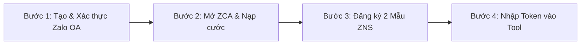

# 📱 HƯỚNG DẪN TÍCH HỢP & VẬN HÀNH ZALO ZNS DÀNH CHO TRUNG TÂM
## CHUYÊN TRÁCH: BỘ PHẬN ZALO SERVICE & TỰ ĐỘNG HÓA (NGƯỜI 3)

> **Tài liệu hướng dẫn & chuyển giao kỹ thuật dành cho:** Cố vấn / Thầy giáo Trung tâm, Quản trị viên và Đội ngũ phát triển hệ thống.  
> **Mục tiêu:** Cung cấp quy trình từng bước đăng ký Zalo Doanh nghiệp (ZNS), đăng ký mẫu tin duyệt, và cơ chế chuyển đổi một chạm từ **Demo (Mock)** sang **Chính thức (Production)**.

---

## 📌 PHẦN 1: TỔNG QUAN VỀ DỊCH VỤ ZALO NOTIFICATION SERVICE (ZNS)

### 1.1. ZNS là gì?
**ZNS (Zalo Notification Service)** là giải pháp gửi tin nhắn chăm sóc khách hàng chính thức từ **Zalo Official Account (OA)** của Doanh nghiệp tới số điện thoại của Phụ huynh:
* ✅ **Tên thương hiệu chính chủ:** Tin nhắn hiển thị tên Trung tâm tiếng Anh (có tích vàng xác thực), tăng độ tin cậy và chuyên nghiệp.
* ✅ **Không sợ bị khóa tài khoản:** Là kênh gửi tin hợp pháp 100% của Zalo, không dùng bot cào lậu nên an toàn tuyệt đối.
* ✅ **Chi phí:** Khoảng **200đ – 300đ / tin nhắn** (chỉ tính phí khi tin nhắn gửi đến điện thoại phụ huynh thành công).
* ✅ **Tối ưu cước:** Vì hệ thống **chỉ gửi tin cho học sinh vắng** và **buổi có kiểm tra**, một tháng mỗi lớp 20 học sinh chỉ tốn trung bình khoảng **15.000đ – 25.000đ** tiền cước Zalo!

---

## 🚀 PHẦN 2: QUY TRÌNH 4 BƯỚC ĐĂNG KÝ CHO TRUNG TÂM

Để đưa hệ thống vào chạy thật, Thầy / Trung tâm chỉ cần thực hiện 4 bước sau:



---

### BƯỚC 1: Đăng ký & Xác thực Zalo Official Account (Zalo OA)
1. Truy cập: [https://oa.zalo.me/manage](https://oa.zalo.me/manage) và đăng nhập bằng số điện thoại của Thầy / Trung tâm.
2. Bấm **Tạo Official Account mới** -> Chọn loại tài khoản **Doanh nghiệp**.
3. Điền thông tin:
   - **Tên OA:** Tên của Trung tâm Tiếng Anh (Ví dụ: *Anh Ngữ Quốc Tế ABC*).
   - **Danh mục:** Giáo dục - Đào tạo.
   - **Ảnh đại diện & Ảnh bìa:** Logo trung tâm.
4. **Nộp hồ sơ xác thực:** Tải lên Giấy phép thành lập trung tâm hoặc Giấy chứng nhận Đăng ký kinh doanh (Zalo duyệt trong 1 - 3 ngày làm việc để cấp tích vàng).

---

### BƯỚC 2: Mở tài khoản Zalo Cloud Account (ZCA) & Nạp tiền cước
1. Truy cập cổng thanh toán: [https://account.zalo.cloud](https://account.zalo.cloud).
2. Liên kết tài khoản ZCA với Zalo OA vừa tạo ở Bước 1.
3. Nạp trước một khoản ngân sách thử nghiệm (Ví dụ: **100.000đ – 200.000đ**, đủ gửi cho cả trung tâm trong 2 - 3 tháng).
4. Hệ thống sẽ tự động trừ dần khi có tin nhắn gửi thành công. Khi số dư sắp hết, Zalo sẽ gửi tin nhắc Thầy nạp thêm.

---

### BƯỚC 3: Đăng ký duyệt 2 Mẫu Tin ZNS (Template)
Truy cập [https://zns.oa.zalo.me/template](https://zns.oa.zalo.me/template) -> Bấm **Tạo mẫu tin mới**. Nhóm phát triển đã soạn sẵn 2 mẫu chuẩn theo đúng quy định kiểm duyệt của Zalo:

#### 🔔 Mẫu 1: Thông báo Điểm danh Vắng học
* **Mục đích:** Thông báo học tập (Chăm sóc khách hàng).
* **Tiêu đề mẫu:** `THÔNG BÁO VẮNG HỌC`
* **Nội dung đăng ký:**
  > *"Kính gửi phụ huynh bé `<student_name>`, Trung tâm `<center_name>` xin thông báo: Hôm nay ngày `<date>`, bé vắng mặt trong buổi học ca `<shift>`. Quý phụ huynh vui lòng liên hệ trung tâm nếu cần hỗ trợ sắp xếp lịch học bù. Trân trọng!"*
* **Tham số biến:**
  - `<student_name>`: Tên học sinh
  - `<center_name>`: Tên trung tâm
  - `<date>`: Ngày học (dd/mm)
  - `<shift>`: Ca học (17:30 - 19:00)

#### 🔔 Mẫu 2: Thông báo Kết quả Bài kiểm tra
* **Mục đích:** Thông báo kết quả học tập.
* **Tiêu đề mẫu:** `KẾT QUẢ BÀI KIỂM TRA`
* **Nội dung đăng ký:**
  > *"Kính gửi phụ huynh bé `<student_name>`, Trung tâm `<center_name>` xin gửi kết quả bài kiểm tra của bé trong buổi học ca `<shift>`:\n- Chuyên cần: Có mặt đúng giờ.\n- Bài kiểm tra: `<exam_name>` (Ngày kiểm tra: `<date>`).\n- Điểm số: `<score>` / 10 - Xếp loại: `<rank>`.\nChi tiết bài làm phụ huynh có thể liên hệ giáo viên phụ trách. Trân trọng!"*
* **Tham số biến:**
  - `<student_name>`, `<center_name>`, `<shift>`, `<exam_name>`, `<date>`, `<score>`, `<rank>`.

*(Zalo thường phê duyệt mẫu tin trong vòng 24 giờ làm việc).*

---

### BƯỚC 4: Lấy mã kết nối & Nhập vào Phần mềm (Chỉ mất 1 phút)
1. Truy cập [https://developers.zalo.me](https://developers.zalo.me) -> Tạo ứng dụng (App).
2. Lấy 4 thông số:
   - `OA ID`
   - `App ID`
   - `Secret Key`
   - `Access Token`
3. Đăng nhập vào phần mềm bằng tài khoản **Super Admin** hoặc **Admin Trung tâm**:
   - Vào menu **Quản trị Trung tâm** -> Bấm nút **"Cấu hình Zalo OA"**.
   - Dán 4 thông số vào form -> Nhấn **Lưu & Kích hoạt**.
4. **Hệ thống tự động kích hoạt:** Kể từ thời điểm này, toàn bộ tin nhắn sẽ được bắn thật 100% qua Zalo ZNS!

---

## 🧪 PHẦN 3: CƠ CHẾ CHẠY THỬ NGHIỆM TRƯỚC KHI CÓ ZALO THẬT (DEMO MODE)

Trong thời gian Thầy đang làm thủ tục giấy tờ với Zalo, hệ thống của nhóm bạn **ĐÃ SẴN SÀNG CHẠY THỬ NGHIỆM 100%** thông qua 2 cơ chế:

### Cơ chế 1: Xem trực tiếp trên Giao diện Web
* Mỗi khi giáo viên bấm "Gửi Zalo" hoặc cuối ca tự động quét, hệ thống tự động ghi nhật ký vào mục **"Lịch sử Zalo"** (`/zalo-history`).
* Thầy mở màn hình ra sẽ thấy danh sách từng phụ huynh, số điện thoại, nội dung tin nhắn và trạng thái `[Demo / Giả lập]`.

### Cơ chế 2: Bắn tin nhảy "Ting Ting" về điện thoại Thầy qua Telegram / Discord 🌟
Để tạo ấn tượng mạnh nhất khi Thầy kiểm thử hộp đen, hệ thống hỗ trợ forward tin nhắn Demo về Telegram của Thầy:
1. Mở file `.env` trong thư mục `english-center-backend/`.
2. Điền thông tin Bot Telegram hoặc Discord Webhook:
   ```env
   TELEGRAM_BOT_TOKEN="123456789:ABCDefgh..."
   TELEGRAM_CHAT_ID="987654321"
   # Hoặc dùng Discord Webhook
   DISCORD_WEBHOOK_URL="https://discord.com/api/webhooks/..."
   ```
3. Mỗi khi hệ thống kích hoạt gửi tin cho học sinh vắng hay báo điểm, **điện thoại của Thầy sẽ rung thông báo "Ting ting" ngay lập tức**, nội dung hiển thị chính xác như một tin nhắn Zalo thật!

---

## 🛡️ PHẦN 4: CÁC NGUYÊN TẮC BẢO VỆ ĐÃ ĐƯỢC LẬP TRÌNH SẴN

Hệ thống Zalo Service do Bạn phụ trách đã được lập trình sẵn các cơ chế bảo vệ tối tân:
1. **Chống gửi trùng lặp (Idempotency):** Trước khi gửi bất kỳ tin nào, hệ thống đối chiếu bảng `nhat_ky_zalo`. Nếu tin loại đó đã gửi cho học sinh trong buổi học đó rồi thì tự động bỏ qua. Giáo viên có bấm nhầm 10 lần cũng không bị gửi trùng!
2. **Cô lập lỗi theo từng học sinh (Error Isolation):** Nếu 1 học sinh bị sai số điện thoại, hệ thống ghi nhận lỗi riêng cho bạn đó và tiếp tục gửi bình thường cho các học sinh còn lại, không làm dừng tiến trình của cả lớp.
3. **Chống nghẽn lệnh (Rate Limiting):** Tự động giãn cách 0.05s - 0.3s giữa các tin gửi để tránh bị Zalo chặn.
4. **Cảnh báo hết tiền:** Nếu tài khoản ZNS hết số dư (mã lỗi `-124`, `-108`), hệ thống tự động dừng gửi, ghi log trạng thái `OUT_OF_BALANCE` và hiện thông báo đỏ trên màn hình Admin.
5. **Khung giờ an toàn ban đêm (07:00 – 21:30):** Các bài thi giấy nhập sau 21:30 tối được tự động đưa vào hàng đợi `HenGioGuiTin` để gửi vào 07:30 sáng hôm sau, không làm phiền giấc ngủ của phụ huynh.

---

> 💡 **Kết luận:** Bộ phận Zalo Service & Tự động hóa đã hoàn tất việc thiết kế, lập trình và tài liệu hóa. Khi Thầy hoàn tất giấy tờ, chỉ cần nhập Token vào là hệ thống chạy thật ngay lập tức!
