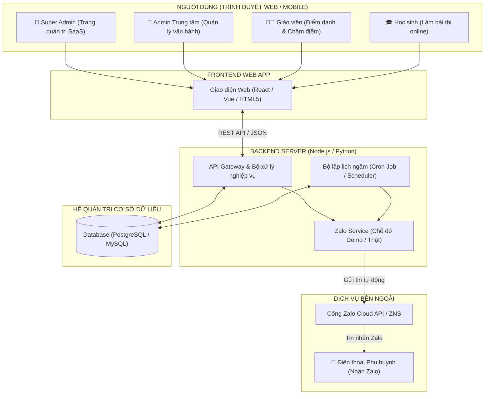
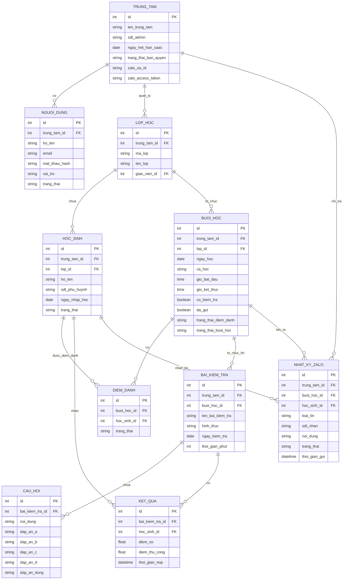
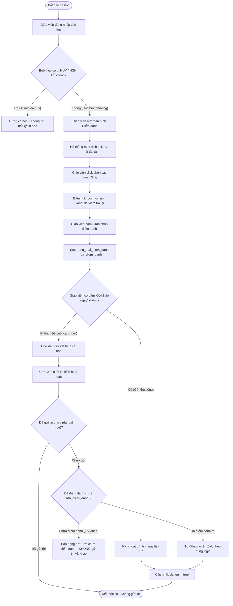
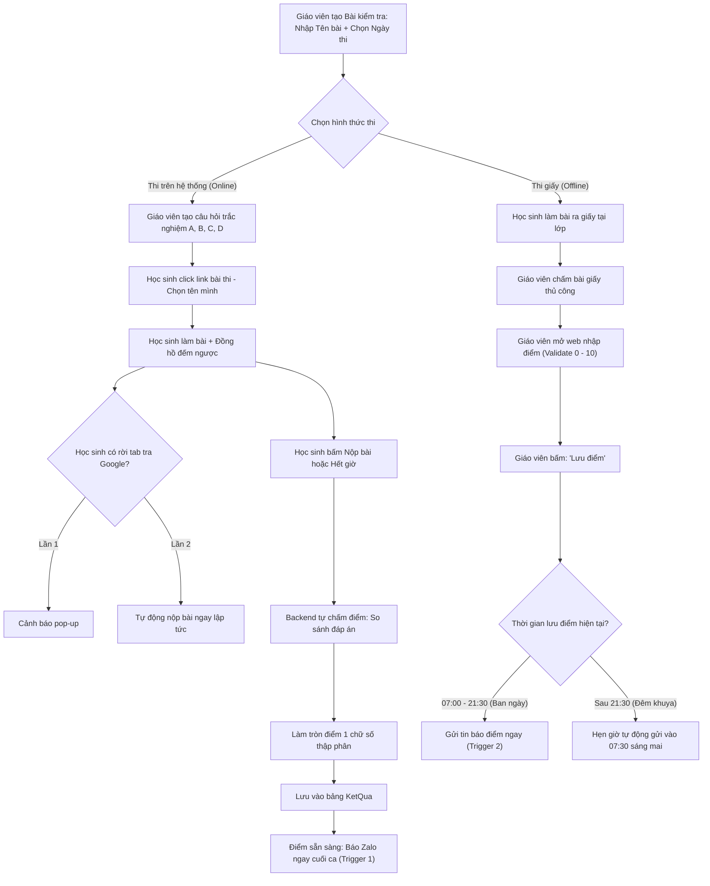
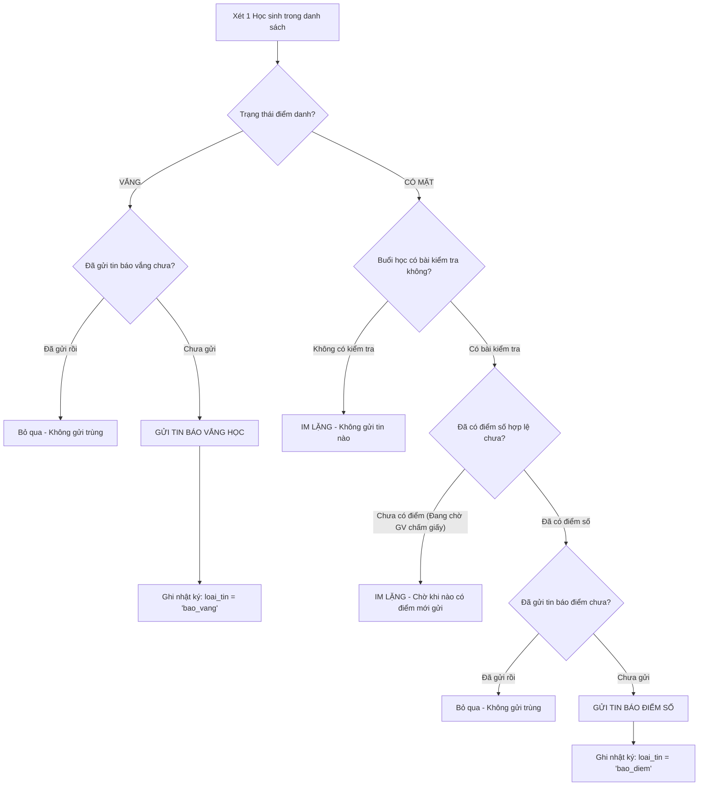
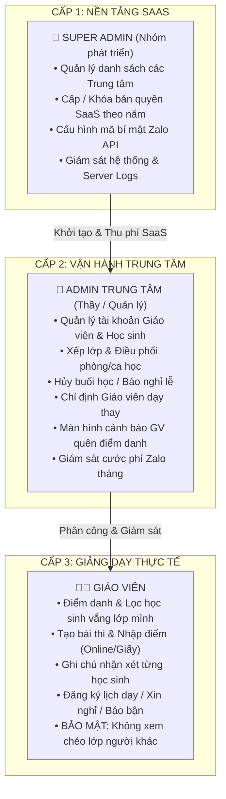

# 📊 SƠ ĐỒ HỆ THỐNG: TOOL QUẢN LÝ TRUNG TÂM TIẾNG ANH

> **Tài liệu trực quan hóa kiến trúc & quy trình nghiệp vụ**  
> Dự án: Phần mềm Quản lý Trung tâm Tiếng Anh (Mô hình B2B SaaS)  
> Nhóm phát triển: 3 thành viên

---

## 🏛️ 1. SƠ ĐỒ KIẾN TRÚC TỔNG THỂ (SYSTEM ARCHITECTURE)

Sơ đồ mô tả cách các thành phần trong hệ thống kết nối với nhau từ giao diện người dùng đến server và các dịch vụ bên ngoài:

---

## 🗄️ 2. SƠ ĐỒ THỰC THỂ CƠ SỞ DỮ LIỆU (DATABASE ERD)

Sơ đồ thể hiện mối quan hệ giữa các bảng trong hệ thống, bao gồm bảng trung tâm, người dùng, lớp học, buổi học, điểm danh, bài kiểm tra và nhật ký tin nhắn:

---

## 🔄 3. QUY TRÌNH ĐIỂM DANH & KÍCH HOẠT TỰ ĐỘNG CUỐI CA

Sơ đồ thể hiện toàn bộ vòng đời của một buổi học từ lúc vào lớp cho đến khi kết thúc ca học:

---

## 📝 4. QUY TRÌNH KIỂM TRA: THI ONLINE VS THI GIẤY

Sơ đồ so sánh hai luồng làm bài thi và cách xử lý điểm số:

---

## 📲 5. CÂY QUYẾT ĐỊNH BẮN TIN NHẮN ZALO (DECISION TREE)

Sơ đồ thuật toán mà Server sử dụng trước khi quyết định gửi tin cho một học sinh:

---

## 👥 6. MÔ HÌNH PHÂN QUYỀN 3 CẤP (RBAC HIERARCHY)

Sơ đồ thể hiện ranh giới quản lý và phân quyền giữa 3 vai trò trong hệ thống:

---

> 💡 **Hướng dẫn xem sơ đồ:** Tài liệu này dùng cú pháp chuẩn **Mermaid**. Khi mở trên GitHub hoặc VS Code / Markdown Preview, các khối mã trên sẽ tự động vẽ thành các sơ đồ đồ họa trực quan và tương tác được.

